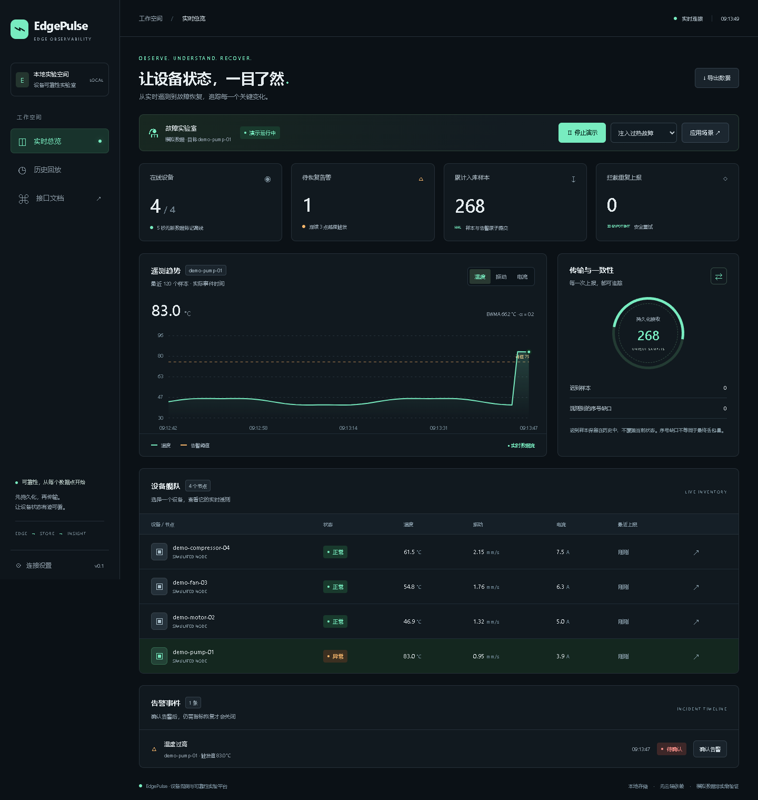
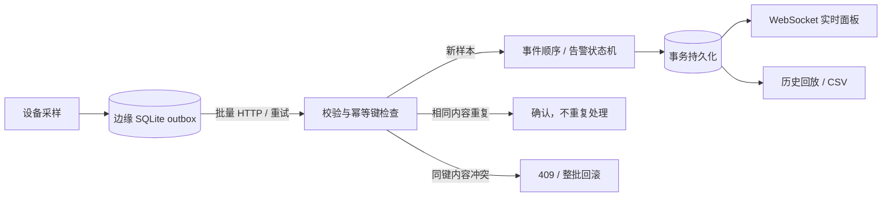
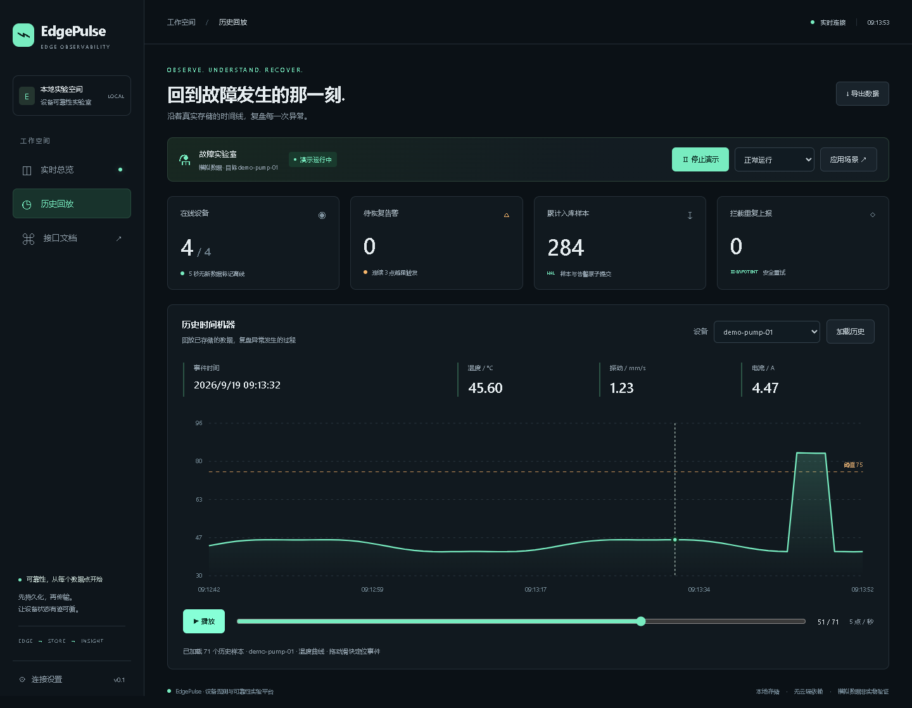

<div align="center">

# EdgePulse

**设备遥测 · 可靠上报 · 故障复盘**

一个可以在本地完整运行的设备观测与可靠性实验平台。

Python / FastAPI / SQLite WAL / WebSocket / Vanilla JS

[快速启动](#快速启动) · [工程设计](#工程设计) · [演示流程](docs/demo-guide.md) · [协议文档](docs/architecture.md) · [性能测量](docs/performance.md)

</div>



设备断线后，缓存的数据怎样可靠补传？服务端已经写入、响应却丢失时，重试会不会重复计算？历史数据迟到，是否会覆盖当前状态？一个告警被人确认，是否意味着故障已经恢复？

EdgePulse 把这些问题做成可以**运行、注入故障、查看结果、执行测试**的项目。数据从边缘持久化队列进入服务端事务，再驱动实时面板、告警状态机和历史回放。

> 默认演示使用明确标注的模拟数据。项目尚未完成实物传感器验证。故障检测采用可解释的阈值和状态机，不宣称经过工业数据验证的 AI 诊断。

## 能做什么

| 能力 | 可操作的表现 | 工程实现 |
|---|---|---|
| 实时监测 | 四节点演示、温度/振动/电流、在线状态 | HTTP 批量采集、WebSocket 推送 |
| 断线缓存 | 暂停发送后恢复，自动补传 | SQLite outbox，先落盘，完整确认后删除 |
| 幂等接收 | 同一批反复发送，样本数不增加 | device_id + boot_id + seq 唯一键 |
| 冲突保护 | 同键不同内容返回 409，整批回滚 | 样本、状态、告警、计数同一事务 |
| 故障注入 | 过热、振动异常、断联、恢复正常 | 可重复的合成遥测场景 |
| 告警处理 | 连续越限触发、确认、恢复及审计 | 持久化防抖、迟滞、独立 ACK 状态 |
| 迟到处理 | 旧数据可回放，当前指标不倒退 | 事件时间和启动周期内序号检查 |
| 历史复盘 | 播放、暂停、拖动定位、导出 CSV | 读取已存样本，丢弃过期查询结果 |

## 快速启动

需要 **Python 3.10 或更新版本**。日常运行不需要 Node.js、独立数据库服务或云端 API。

### Windows

直接双击 **`start.cmd`**。脚本创建项目内虚拟环境、安装依赖，然后启动服务，首次安装需要网络。也可以在根目录执行：

```powershell
python -m venv .venv
.\.venv\Scripts\python.exe -m pip install -c requirements.lock -e ".[dev]"
.\.venv\Scripts\python.exe -m edgepulse.cli serve
```

打开 **[http://127.0.0.1:8000](http://127.0.0.1:8000)**，点击「启动演示」。选择「注入过热故障 → 应用场景」，观察曲线与告警，再切回正常运行。

### macOS / Linux

```bash
python3 -m venv .venv
source .venv/bin/activate
python -m pip install -c requirements.lock -e ".[dev]"
edgepulse serve
```

`requirements.lock` 固定本次验证的运行依赖。PyPI 较慢时，可以为安装命令增加 `--index-url https://pypi.tuna.tsinghua.edu.cn/simple`。

### 独立设备代理：实际 HTTP 断线补传

保持服务端运行，在另一个终端执行：

```powershell
.\.venv\Scripts\python.exe -m edgepulse.cli agent --offline-seconds 10
```

前 10 秒只缓存，随后批量发送。控制台输出 `buffering pending=...` 和 `delivered=... pending=...`，网页出现 `edge-sensor-01`。代理验证实际 HTTP 与磁盘队列；网页内置模拟器用于快速故障演示。

停止服务端、保留代理运行，再重启服务端，也能观察退避重试和补传。Ctrl+C 退出代理不会删除未发送数据。运行多个代理时，请为每个代理指定不同的 `--device` 和 `--outbox`。

## 工程设计



**传输语义。** 至少一次传输，接收端在持久化幂等键范围内只处理一次。如果服务端提交后响应丢失，代理保留队列，再次发送得到重复确认后清队列。这不是跨系统全局 exactly-once 承诺。

**事务边界。** 一个批次的样本、当前状态、防抖计数、告警和统计整体提交。键冲突整体回滚。SQLite WAL 允许读者与写者并行，但仍是单写者，不能把它当作分布式时序数据库。

**告警状态。** 连续 3 点超过阈值开启，连续 3 点低于恢复阈值关闭。确认只表示已经知悉，不伪装成恢复。计数与状态持久化，重启不清空。EWMA 温度趋势仅用于平滑展示。

| 指标 | 开启条件 | 恢复条件 |
|---|---|---|
| 温度 | 连续 3 点 > 75 °C | 连续 3 点 < 70 °C |
| 振动 | 连续 3 点 > 4.5 mm/s | 连续 3 点 < 3.5 mm/s |
| 电流 | 连续 3 点 > 12 A | 连续 3 点 < 10 A |

规则位于 `edgepulse/models.py`，更多细节见 [架构与协议](docs/architecture.md)。

## 接入自己的数据

向 `POST /api/ingest` 发送 JSON。`ts` 是 Unix 毫秒；`boot_id` 在设备重启后更换，`seq` 在同一启动周期递增。

```python
import time
import uuid
import httpx

sample = {
    "device_id": "my-sensor-01", "boot_id": uuid.uuid4().hex,
    "seq": 0, "ts": int(time.time() * 1000),
    "temperature": 42.3, "vibration": 1.15, "current": 5.2,
}
response = httpx.post("http://127.0.0.1:8000/api/ingest", json={"samples": [sample]})
response.raise_for_status()
print(response.json())
# {"accepted": 1, "duplicates": 0, "late": 0, "sequence_gaps": 0}
```

该协议可供 ESP32、树莓派或已有网关接入；实际传感器校准、固件和硬件联调不包含在当前验证范围内。

## 验证与复现

```powershell
# 后端与可靠性测试
.\.venv\Scripts\python.exe -m pytest -q
# 前端请求乱序回归（需要 Node.js）
node scripts/test_ui_state.cjs
# 本地存储基准
.\.venv\Scripts\python.exe scripts/benchmark.py
# 真实浏览器端到端验证
.\.venv\Scripts\python.exe -m pip install playwright
.\.venv\Scripts\python.exe scripts/browser_check.py --channel chrome
```

没有 Chrome 时，执行 `python -m playwright install chromium`，然后使用 `--channel chromium`。浏览器脚本启动隔离数据库，检查故障触发/确认/恢复、历史播放/定位、CSV 下载、离线检测与手机页面溢出，截图保存在 `docs/assets/`。

本次 Windows / Python 3.10 基准，每批 100 条、每轮 10,000 条、三轮测量，单写者入库约 **11,188–11,393 条/秒**，每批 p95 **9.91–10.53 ms**。每轮全部重传后仍仅保留 10,000 条唯一样本。**这不是 HTTP 吞吐或实物采集性能。** [原始数据](docs/benchmark-results.json) · [测量口径](docs/performance.md)。

仓库包含 GitHub Actions：Windows/Linux、Python 3.10/3.12，以及 Linux Chromium 流程。工作流配置不代表远端已经通过，请以实际 Actions 结果为准。



## 运行与数据

- 服务数据库默认 `data/edgepulse.db`；代理队列 `data/outbox.db`，均被 Git 忽略。
- 默认只监听 `127.0.0.1`。设置 `EDGEPULSE_TOKEN` 启用共享令牌认证，在页面「连接设置」输入相同令牌；页面只在内存中保存它。
- 非回环监听强制要求令牌：`$env:EDGEPULSE_TOKEN = '你生成的令牌'`，然后 `edgepulse serve --host 0.0.0.0`。外部访问应另行配置 HTTPS 反向代理。
- 可选 Docker：设置令牌后执行 `docker compose up --build`。只映射本机端口，使用持久化数据卷。当前环境未执行 Docker 构建，以实际构建结果为准。
- SQLite 使用本地磁盘。备份请停止服务后复制，或使用 SQLite 备份 API；运行时仅复制 `.db` 可能遗漏 WAL 中的数据。

## 源码导读

```text
edgepulse/
  models.py       数据契约与阈值
  store.py        幂等事务、当前状态、告警与查询
  agent.py        磁盘 outbox 与确认校验
  simulator.py    合成数据、故障注入、协作式停止
  app.py          HTTP / WebSocket / 认证
  cli.py          服务和设备代理入口
  static/         无外部 CDN 的监控与回放界面
tests/            契约、异常、重启、状态机测试
scripts/          浏览器验证、前端回归、性能基准
docs/             架构、演示、性能证据和实际截图
```

先读 `tests/test_store.py` 理解行为契约，再读 `store.py` 和 `agent.py`。讲解与扩展线索见 [项目讲解提纲](docs/walkthrough.md)。

## 当前边界

这是单实例工程实验平台。尚无 MQTT、多租户、数据保留/压缩、跨节点复制、高可用、实物验证或工业级安全认证。历史 API 每次最多 10,000 条，网页回放最多 2,000 条；告警最多展示 500 条未恢复和最近 50 条已恢复事件。序号缺口是观察到的跳号量，补传不扣回，不等于最终丢包率。

设备身份来自载荷和共享令牌，不构成每设备独立认证。令牌持有人也能控制演示和确认告警。应用到实际场景需继续完善权限、限流、保留策略与真实设备测试。
