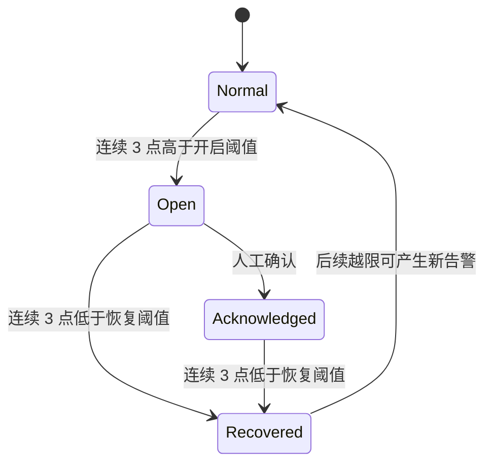

# 架构与数据协议

## 选择与边界

HTTP JSON 便于验证异常路径，并对接不同语言客户端。SQLite 消除独立数据库部署成本；WAL 适用于本地单实例网关，但仍为单写者。WebSocket 每秒推送快照，断线按 1/2/4/8/10 秒重连；趋势每 2 秒查询最近 120 点。这不是逐事件消息总线，快照之间的采样点仍保存在历史中。请使用单进程、单 worker。

| 表 | 作用 | 约束 |
|---|---|---|
| samples | 规范化 JSON 原始样本 | `(device_id, boot_id, seq)` 唯一；设备/时间索引 |
| devices | 最新状态、EWMA、越限计数 | 每设备一行 |
| alerts | 开启、确认与恢复 | 每设备每指标至多一条未恢复告警 |
| audit | 状态变更日志 | 按 ID 排序 |
| counters | 接收、重复、迟到、跳号计数 | 与样本同事务更新 |

写入使用 `BEGIN IMMEDIATE`，锁等待上限 10 秒；异常回滚并关闭连接。快照在同一读事务中读取，避免设备与告警来自不同提交时点。服务和代理各自有独立数据库，默认 FULL 同步模式。不承诺硬件或文件系统损坏时绝不丢数据。

## 载荷契约

`POST /api/ingest` 接收 `{"samples": [Sample, ...]}`，每批 1–500 条。

| 字段 | 类型 / 单位 | 约束 |
|---|---|---|
| device_id | 字符串 | 1–48 位字母、数字、下划线、连字符 |
| boot_id | 字符串 | 1–64 位，同上；每次启动更换 |
| seq | 整数 | 0–2^53−1，拒绝布尔和浮点 |
| ts | Unix 毫秒整数 | 非负，最多超前服务器 60 秒 |
| temperature | 数值 / °C | −100 至 300，必须有限 |
| vibration | 数值 / mm/s | 0 至 1000，必须有限 |
| current | 数值 / A | 0 至 10000，必须有限 |

三个指标均必填，拒绝额外字段。扩展设备类型时，应引入明确的版本化 schema。

```json
{"accepted": 100, "duplicates": 0, "late": 0, "sequence_gaps": 0}
```

`late` 是 `accepted` 的子集。跳号计数只累计同一 boot 内向前跳过的序号，新 boot 不继承旧 boot 的缺口，补传不回扣。

200 表示提交成功；409 表示同键内容冲突、整批回滚；422 表示载荷或范围错误、未写入；401 表示认证失败。代理仅在 `accepted + duplicates == 本批条数` 且二者为非负整数时删除队列。409 应调查数据源，不应删队列跳过。

## 时间顺序与状态机

比当前事件时间更旧，或同 boot 序号不大于当前序号，被视为迟到。新 boot 时间戳与当前值相等也不更新实时状态。迟到样本存入历史，但不触发告警、不更新 EWMA。新 boot 时间更晚时可以重置序号。



开启/恢复阈值之间是迟滞区间，等于阈值不计入高于/低于。计数按点而非持续秒数，所以采样频率会影响触发所需时长。计数跨重启保留。

开启和恢复使用事件时间，确认使用服务端时间。数据延迟时审计时间戳可能不递增，应按审计 ID 读取变化顺序。

## API 索引

| 路径 | 功能 |
|---|---|
| GET /health | 最小健康响应，无业务数据 |
| POST /api/ingest | 批量上报 |
| GET /api/snapshot | 设备、告警、统计、模拟器和阈值 |
| GET /api/history/{device_id} | from_ts/to_ts 含边界，limit 1–10000；区间内最新 N 条按时间正序返回 |
| GET /api/export/{device_id} | 最近最多 10000 条 CSV |
| POST /api/alerts/{id}/ack | 确认 open，重复确认/不存在返回 404 |
| GET /api/alerts/{id}/audit | 变更日志 |
| POST /api/demo | action: start/stop/normal/overheat/vibration/offline |
| WS /ws | 首包 `{"token":"..."}`，无认证可空；每秒快照 |
| GET /docs | OpenAPI 交互文档 |

所有 `/api` 共用 Bearer 认证；WebSocket 令牌放首帧，不放 URL。页面与 API 同源，显式跨来源请求被拒绝。首页与接口结构文档不含业务数据。无令牌只适合 localhost 实验。

## 参考

- [SQLite WAL 官方说明](https://www.sqlite.org/wal.html)：并发与文件系统约束。
- [FastAPI WebSocket](https://fastapi.tiangolo.com/advanced/websockets/) 和 [WebSocket 测试](https://fastapi.tiangolo.com/advanced/testing-websockets/)：连接与测试客户端。
